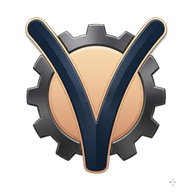
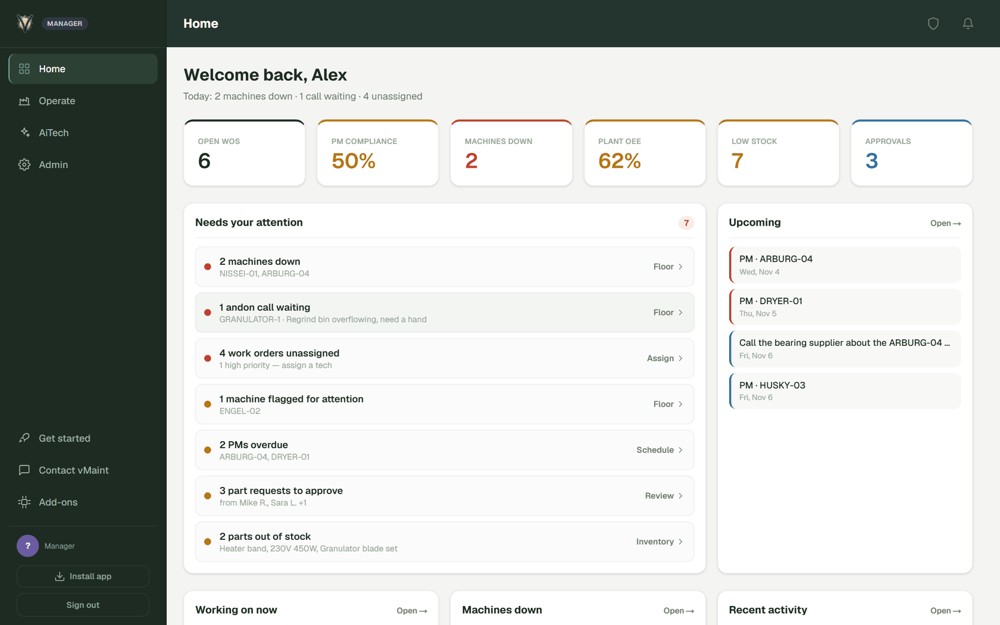
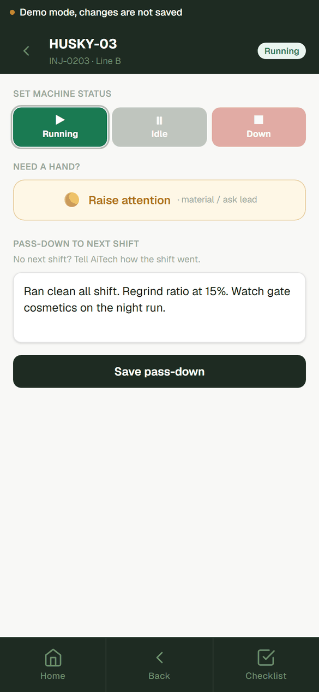
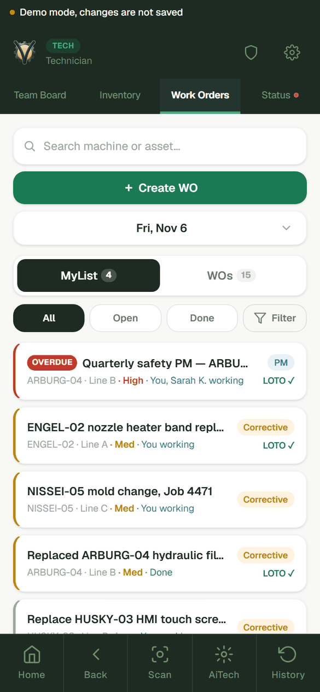
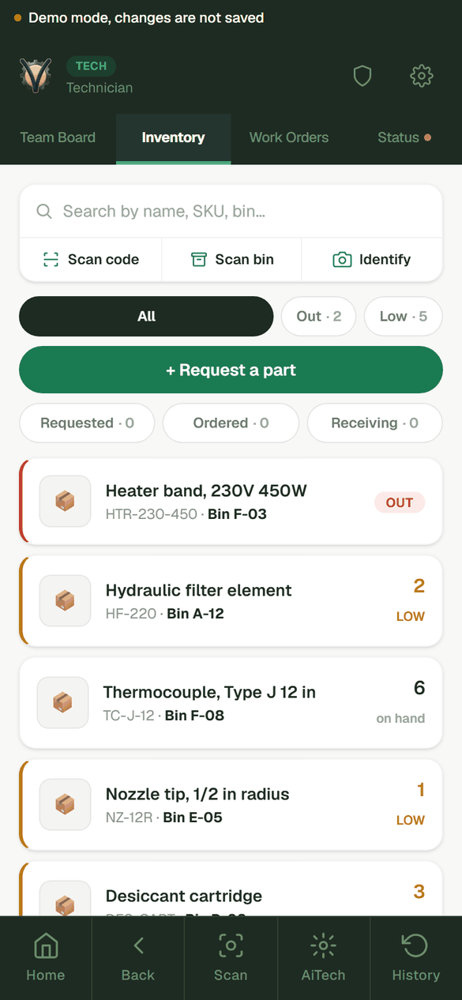
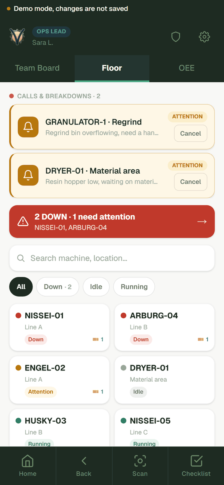
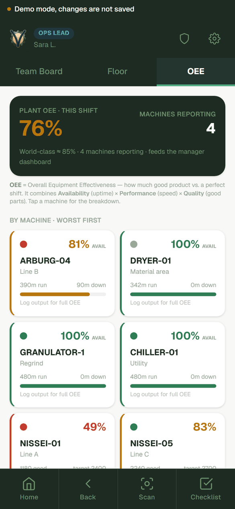
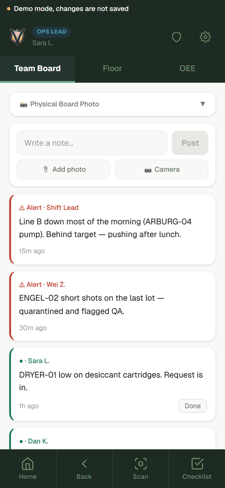
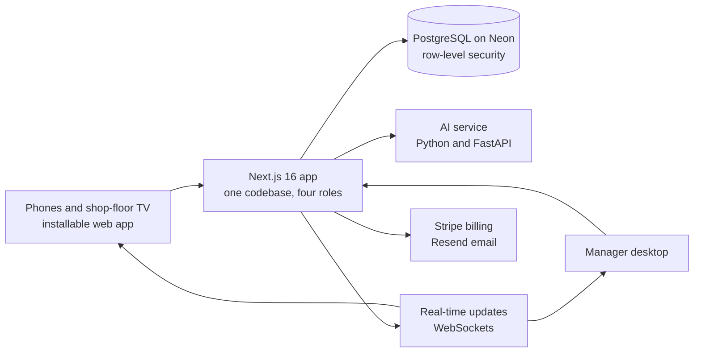

<div align="center">



# vMaint

**Maintenance and production in one app, for small and mid-sized manufacturers.**

[**Try the live demo**](https://demo.vmaint.com/demo) &nbsp;·&nbsp; [Website](https://vmaint.com) &nbsp;·&nbsp; [Architecture](docs/ARCHITECTURE.md) &nbsp;·&nbsp; [Contact](https://vmaint.com/contact)

<br />



</div>

<br />

## What it is

Small plants usually run on paper, spreadsheets, and group chats, or they split the work across a CMMS, an MES, and tools that never talk to each other. Enterprise systems are too heavy and too expensive for them.

vMaint puts that work in one app: work orders, preventive maintenance, spare parts, downtime tracking, and machine performance (OEE). Operators, technicians, ops leads, and managers share the same live picture of the floor. It runs on the phones people already carry, and setup takes about an hour.

> This repository is a public showcase. It documents what vMaint is, how it is built, and who builds it. The product itself is proprietary and runs at [vmaint.com](https://vmaint.com).

## See it

One app, with a view built for each job on the floor. All screens below are from the [live demo](https://demo.vmaint.com/demo), which runs on a sample injection-molding plant with no signup. Nothing you do there is saved.

<table>
  <tr>
    <td align="center" width="33%"><br /><sub><b>Operator</b><br />One tap for machine status, plus shift pass-downs</sub></td>
    <td align="center" width="33%"><br /><sub><b>Technician</b><br />Work orders, with LOTO status on each job</sub></td>
    <td align="center" width="33%"><br /><sub><b>Inventory</b><br />Scan a code or a bin, see what is low or out</sub></td>
  </tr>
  <tr>
    <td align="center"><br /><sub><b>Ops lead</b><br />Andon calls and live status for every machine</sub></td>
    <td align="center"><br /><sub><b>OEE</b><br />Plant and per-machine performance, worst first</sub></td>
    <td align="center"><br /><sub><b>Team board</b><br />Alerts and notes that replace the group chat</sub></td>
  </tr>
</table>

## What it does

| Area | What you get |
|---|---|
| **Maintenance** | Work orders from a phone, with photos. Preventive maintenance that schedules itself. LOTO records and asset history. |
| **Inventory** | Barcode and bin scanning, low-stock alerts, and a request, order, and receive flow. |
| **Production** | Running, idle, and down status, downtime reasons, output against target, and OEE per machine and shift. |
| **Floor communication** | Team board, andon calls, floor-wide safety alerts, shift pass-downs, and a shop-floor TV kiosk. |
| **Outside vendors** | A no-login portal so a contractor can report work on the record. |
| **AiTech** | An AI assistant for parts, procedures, machine issues, and work orders. |
| **Machine data** | Optional SCADA, PLC, and IoT integration, set up and quoted per shop. |

## How I designed it

I worked as a mechanical engineer, then on the floor as an operator and technician, then moved into automation, SCADA, and software development. Most of the design below comes from having been the person using this kind of software.

**The floor comes first.** Someone standing at a faulted machine will not fill in a long form. So the main actions are one tap or one photo, and the app installs on any phone with no app store.

**It works before anything is wired up.** Most small plants have no SCADA and no budget for a long integration. Operators tap Running, Idle, or Down, and that alone produces downtime and availability data. Machine connections can come later.

**One record instead of three systems.** Maintenance and production read and write the same data. A fault, its work order, the parts used, and the downtime it caused all sit together, so nobody has to reconcile separate tools.

**One app, four roles.** All four roles run the same application, gated by capability flags rather than separate builds. That keeps one code path, and it keeps a manager on the floor and an operator at a machine looking at the same facts.

**Tenant isolation lives in the database.** Every tenant table has Postgres row-level security. Outside the one function that sets the tenant for a transaction, queries return zero rows, so a forgotten filter cannot leak another company's data.

```ts
// Outside withTenant(), RLS returns zero rows. That is the safety guarantee.
const list = await withTenant(org.id, (tx) => tx.select().from(assets));
```

**The AI service is separate, and its models are switchable.** It runs on its own Python service, so heavier work scales apart from the web app. A provider layer lets it change between hosted models and a local one, which matters to plants that want their data to stay on site.

**The demo cannot touch production.** It is the real app on an isolated deployment with an in-memory seed and no production data or credentials, so anyone can click anything.

**Pricing follows the design.** If the whole floor shares one record, charging per person works against the product. vMaint is priced flat per site, with the whole team included.

## Architecture



The full engineering write-up is in **[docs/ARCHITECTURE.md](docs/ARCHITECTURE.md)**.

| Layer | Technology |
|---|---|
| **Web app** | Next.js 16 (App Router), React 19, TypeScript |
| **UI** | Tailwind CSS v4, shadcn/ui |
| **Data** | PostgreSQL (Neon), Drizzle ORM, row-level security |
| **Auth** | NextAuth v5: Google, Microsoft, and email with password |
| **AI service** | Python, FastAPI, with a switchable model provider layer |
| **Real-time** | WebSockets (Pusher), plus web push notifications |
| **Billing and email** | Stripe, Resend |
| **Hosting** | Vercel for the app, Railway for the AI service |
| **Testing** | Vitest, Playwright, GitHub Actions |

## Pricing

| Plan | Price | For |
|---|---|---|
| **Maintenance** | $200 per site a month | Work orders, PMs, parts, and inventory |
| **Operations** | $600 per site a month | Adds live OEE, downtime, andon, and role dashboards |
| **Connected** | Custom quote | Adds SCADA and IoT integration, built with you |

The whole team is included on every plan. Maintenance and Operations start with a 30-day free trial, with no credit card. See [vmaint.com](https://vmaint.com/#pricing) for details.

## Status

Live in production at [vmaint.com](https://vmaint.com). Cloud now. Local install coming soon. In the public demo, AiTech and outside integrations are simulated, and the demo says so on screen.

## About

Built by **Ender Celik**. I worked as a mechanical engineer, then on the floor as an operator and technician, then moved into automation, SCADA, and software development.

[LinkedIn](https://www.linkedin.com/in/endercelik) &nbsp;·&nbsp; [GitHub](https://github.com/celikender) &nbsp;·&nbsp; [Other projects](https://vmaint.com/projects) &nbsp;·&nbsp; [Contact](https://vmaint.com/contact)

## License

The vMaint name, brand, product, and source code are proprietary. See [LICENSE](LICENSE).
